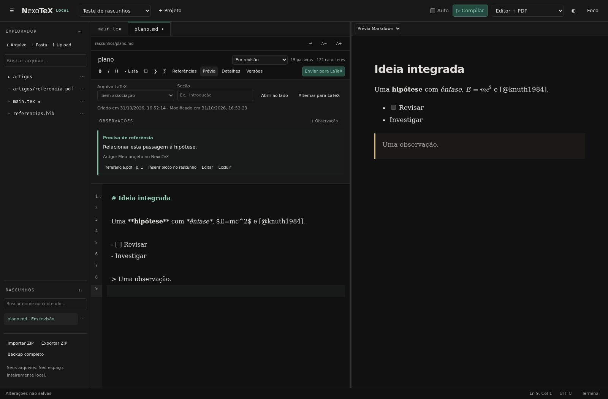

# NexoTeX

Um lugar para escrever trabalhos acadêmicos em LaTeX, consultar PDFs e desenvolver ideias em Markdown. Você abre o navegador, cria um projeto e escreve. Os arquivos e os dados ficam no seu computador.

**Este projeto foi criado com o auxílio do OpenAI Codex.** O Codex foi usado na implementação, nos testes e na documentação, a partir dos requisitos e das decisões do autor. Essa participação é parte da história do projeto, e não uma garantia de que o software esteja livre de erros.



## O que já funciona

- Projetos LaTeX com arquivos reais, pastas, importação e exportação ZIP.
- Editor com abas, realce de sintaxe, autocomplete, busca e salvamento automático.
- Compilação local com pdfLaTeX, latexmk, BibTeX/Biber e suporte a abnTeX2.
- PDF compilado ao lado do texto, com zoom, navegação, seleção e download.
- Rascunhos Markdown com fórmulas, prévia, observações coloridas e histórico de versões.
- Conversão de rascunhos para trechos LaTeX, com prévia e confirmação antes da inserção.
- Leitura de PDFs enviados ao projeto e consulta às referências dos arquivos `.bib`.
- Temas claro e escuro, painéis redimensionáveis e modo de foco.

É uma aplicação de uso pessoal e local. Ainda não há colaboração em tempo real, Pomodoro, biblioteca global de artigos, destaques desenhados sobre PDFs ou sincronização entre fonte e PDF. Veja o [roadmap](docs/ROADMAP.md) para acompanhar o que falta.

## Antes de começar

O caminho testado é **Linux com Docker Engine e Docker Compose v2**. O sistema precisa permitir namespaces de usuário, usados no isolamento da compilação LaTeX. Windows/macOS com Docker Desktop ainda não foram validados; não há garantia de que o sandbox funcione nesses ambientes.

Você precisa de:

- Git para baixar o código.
- Docker e o comando `docker compose` funcionando para seu usuário.
- Um navegador atualizado.
- Pelo menos 5 GB livres para imagens e dependências, além do espaço dos seus documentos.
- Internet para o primeiro build. Depois, a aplicação funciona localmente, sem conta ou CDN.

Você **não precisa instalar Python, Node ou LaTeX no computador** para usar a versão Docker. Eles são preparados dentro das imagens. Node participa apenas do build do frontend.

Confira a instalação:

```bash
git --version
docker --version
docker compose version
```

Se o Docker ainda não estiver instalado, siga as [instruções oficiais para seu sistema](https://docs.docker.com/engine/install/). O aplicativo espera permissão de escrita em `workspace/` para o usuário de UID/GID 1000 do container; veja a seção de problemas comuns se seu usuário Linux tiver outro identificador.

## Baixar e iniciar

No terminal:

```bash
git clone https://github.com/JoabFelippx/latex-editor.git
cd latex-editor
mkdir -p workspace
docker compose up -d --build
```

O primeiro build pode demorar: ele baixa o TeX Live e as demais dependências. Quando terminar, abra **http://localhost:8000**.

Para verificar o estado ou acompanhar as mensagens:

```bash
docker compose ps
docker compose logs -f nexotex
```

`Ctrl+C` fecha o acompanhamento dos logs; o aplicativo continua rodando em segundo plano.

## Seu primeiro documento

1. Clique em **+ Projeto** e dê um nome ao trabalho.
2. Abra `main.tex` no explorador e escreva. O salvamento é automático; a barra inferior indica quando o arquivo foi salvo no disco.
3. Clique em **Compilar** ou pressione **Ctrl+Enter**. O PDF aparece no painel ao lado.
4. Se houver erro, abra o **Terminal** e confira a primeira mensagem. Quando a mensagem indica arquivo e linha, você pode clicar nela para ir ao trecho.
5. Use **Upload** para enviar imagens e bibliografias. Nas configurações do projeto (`···` no explorador), escolha o `.tex` principal quando necessário.

Uma compilação com erro mantém o último PDF válido disponível. Ele pode estar desatualizado até você corrigir o documento e compilar novamente.

Para abrir um trabalho existente, use **Importar ZIP**. O arquivo deve conter os fontes do projeto; não basta enviar apenas o PDF pronto. Importações ZIP aceitam até 25 MB compactados, 100 MB descompactados e 2.000 entradas.

Há um exemplo com abnTeX2 em [`examples/academico/`](examples/academico/). Compacte o conteúdo dessa pasta, deixando `main.tex` na raiz do ZIP, e importe pela interface. O exemplo tem capítulo separado e bibliografia.

## Escrever ideias e consultar artigos

Em **Rascunhos → +**, crie um arquivo como `rascunhos/introducao.md`. Use Markdown para títulos, listas, negrito e fórmulas. Você pode abrir a prévia, um arquivo LaTeX ou um PDF no painel ao lado.

Para ler um artigo, envie o PDF pelo **Upload** e escolha **Artigo PDF** no painel. O limite de upload individual é 10 MB. As observações podem guardar um trecho, a página do artigo, uma referência e uma cor.

Quando o rascunho estiver pronto, use **Enviar para LaTeX**. Escolha o trecho, o arquivo de destino e a posição de inserção; gere a prévia e só então confirme. O rascunho original é mantido. A conversão não acrescenta um preâmbulo: alguns elementos, como links e tabelas, podem exigir pacotes no documento final.

O [guia de Rascunhos](docs/RASCUNHOS.md) explica associações, citações, recuperação de versões e limites da conversão.

## Parar, voltar e atualizar

Parar o aplicativo, preservando os dados:

```bash
docker compose stop
```

Voltar a usar depois:

```bash
docker compose up -d
```

Atualizar o código e reconstruir a imagem:

```bash
git pull --ff-only
docker compose up -d --build
```

Faça um backup antes de atualizar. Os projetos e o volume de dados são preservados nesses comandos. **Não use `docker compose down -v` para atualizar:** o `-v` apaga o volume que contém os metadados e os históricos.

## Onde ficam seus dados

| Local | Conteúdo |
| --- | --- |
| `workspace/<id-do-projeto>/` | Fontes LaTeX, imagens, bibliografias, artigos e rascunhos Markdown. São arquivos reais, acessíveis fora do aplicativo. |
| Volume Docker `nexotex-data` | Banco SQLite, observações, vínculos, versões de rascunhos e PDFs gerados. O nome efetivo do volume recebe o prefixo do projeto Compose. |
| Navegador | Tema, layout, última página de leitura e recuperação de alterações ainda não salvas. |

A pasta `workspace/` fica fora do Git. Publicar ou atualizar o código não deve publicar seus trabalhos acadêmicos.

Use **Exportar ZIP** para os arquivos de um projeto ou **Backup completo** para todos os projetos e os metadados SQLite. Durante o backup, evite editar os arquivos. Guarde o ZIP também fora da pasta do aplicativo, de preferência em outro dispositivo.

O backup completo não inclui preferências do navegador, PDFs gerados que podem ser recompilados nem as cópias antigas de destinos em `/data/transfer-backups`. Estas últimas precisam ser copiadas separadamente se você quiser preservá-las fora do volume.

A restauração ainda é manual: pare o serviço, recoloque `workspace/` no diretório local e `data/metadata.sqlite3` no volume de dados, mantendo permissão para o UID 1000. Reinicie e recompile os documentos. Apenas copiar os fontes de volta não recupera observações e históricos; eles ficam no banco.

## Configuração opcional

Os valores padrão já permitem começar. Para mudar a porta ou o tempo máximo de compilação:

```bash
cp .env.example .env
```

Edite o arquivo, por exemplo:

```dotenv
NEXOTEX_PORT=8001
NEXOTEX_COMPILE_TIMEOUT=180
```

Depois execute `docker compose up -d`. Nesse exemplo, o endereço passa a ser `http://localhost:8001`. O `.env` é local e não entra no Git.

## Se algo não funcionar

**A página não abre.** Confira `docker compose ps` e `docker compose logs --tail=100 nexotex`. O primeiro build precisa terminar. Verifique também se a porta configurada está livre.

**Aparece “permission denied” ao salvar.** O container usa UID/GID 1000. Confira `id -u` e `id -g` no host e as permissões de `workspace/`. Se os identificadores forem diferentes, adapte os IDs de `groupadd`/`useradd` no Dockerfile aos do seu usuário e reconstrua a imagem. O processo da aplicação deve continuar sem privilégios de root.

**Aparece `bwrap: Operation not permitted`.** O host está bloqueando o isolamento por namespaces. A aplicação depende dele e não possui fallback sem sandbox. Esse é um limite importante ao usar Docker Desktop ou hosts com políticas restritivas. Veja a [arquitetura e os limites de segurança](docs/ARCHITECTURE.md).

**Falta um arquivo `.sty` ou `.cls`.** Verifique se o arquivo pertence ao próprio modelo e foi incluído no ZIP. Se for um pacote TeX adicional, inclua a dependência no Dockerfile e reconstrua a imagem. O conjunto atual já inclui abnTeX2, `ulem` e `soul`.

**A compilação foi interrompida por tempo.** O limite padrão é 120 segundos. Confira primeiro se há um loop ou erro no LaTeX; para trabalhos maiores, ajuste `NEXOTEX_COMPILE_TIMEOUT`.

## Segurança e limites

O endereço publicado fica restrito a `127.0.0.1`. O aplicativo não tem login e não foi preparado para ser exposto diretamente à internet ou usado por várias pessoas ao mesmo tempo.

A compilação usa Bubblewrap, limites de recursos e shell escape desabilitado. Para permitir os namespaces internos, o Compose relaxa os perfis seccomp/AppArmor do container. Isso depende do kernel do host e não equivale a uma máquina virtual. Para compilar documentos de origem desconhecida, use um ambiente descartável. Os detalhes estão em [ARCHITECTURE.md](docs/ARCHITECTURE.md).

## Para contribuir

Sugestões, relatos de problemas e contribuições são bem-vindos. Ao relatar um erro, inclua o sistema operacional, as versões do Docker/Compose, o que você fez e a mensagem de erro. Remova informações pessoais antes de anexar logs ou documentos.

- [Desenvolvimento e testes](docs/DEVELOPMENT.md)
- [Arquitetura](docs/ARCHITECTURE.md)
- [Rascunhos](docs/RASCUNHOS.md)
- [Roadmap e limitações conhecidas](docs/ROADMAP.md)
- [Histórico de validação](docs/VALIDATION.md)
- [Orientações para agentes de IA](AGENT.md)

Os testes de integração executam Pandoc e LaTeX de verdade. Para rodar a suíte backend pelo Docker, sem instalar as ferramentas no host:

```bash
docker build --target test -t nexotex-test .
docker run --rm \
  --security-opt seccomp=unconfined \
  --security-opt apparmor=unconfined \
  --security-opt no-new-privileges:true \
  nexotex-test
```

Esses testes usam diretórios temporários. O relatório de validação registra resultados das versões já verificadas; consulte-o junto do código atual ao trabalhar em mudanças.
